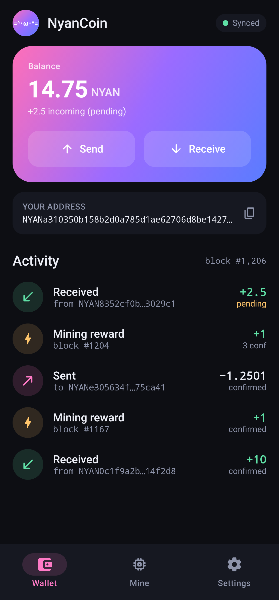
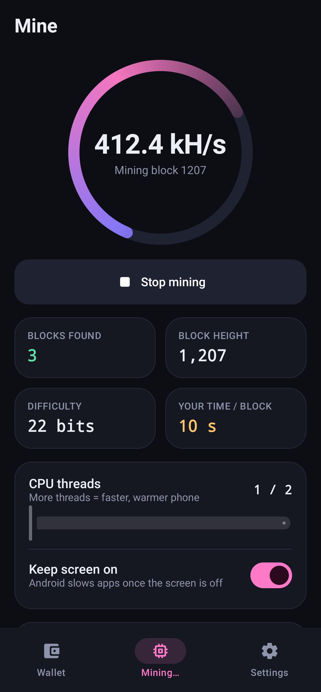
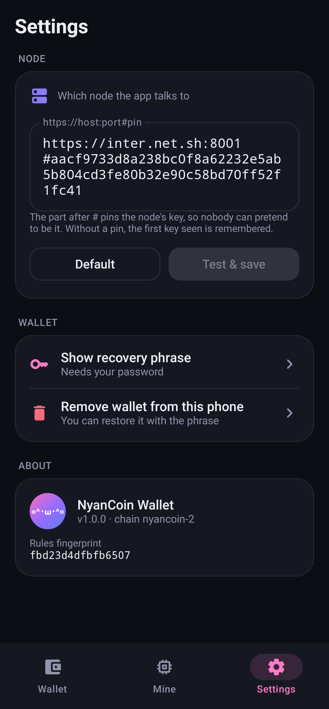

# NyanCoin 🐱

A small peer-to-peer, proof-of-work cryptocurrency in three standalone Python files.

> **Educational project.** It is carefully built and tested, but it has not had an independent security
> audit and it runs on a tiny network. Do not put money you care about into it.

## The three files

| File | For | What it does |
|---|---|---|
| `node.py` | server / node operators | Stores and verifies the chain, talks to other nodes, serves the API. Does **not** mine and holds **no** keys. |
| `wallet.py` | normal users | Creates an encrypted wallet, shows balances, sends coins, shows node status. |
| `miner.py` | miners | Mines blocks using all CPU cores. Connects to any node. Does nothing else. |
| `gui_wallet.py` | normal users who prefer windows | The same wallet with a desktop window: create/restore with a recovery phrase, balance, history, send. |
| `gui_miner.py` | miners who prefer windows | The same miner with a window: start/stop, CPU cores, hashrate, blocks found, balance. |
| `esp8266/` | tinkerers | Arduino miner for an ESP8266, with an optional Waveshare 2.13" e-Paper V4 screen. See `esp8266/README.md`. |

Each file is **self-contained**: you can give someone only `wallet.py` or only `miner.py`.

Requirements: a recent Python 3 (developed and tested on 3.13) and `pip install cryptography`. Nothing else.

## Quick start

The wallet and miner connect to the **official seed node, `inter.net.sh`**, by default (its TLS pin is built
in, so the connection is verified). You don't need to run a node to use NyanCoin.

```bash
pip install cryptography

# 1. Make a wallet (shows your recovery phrase, then asks for a password, 12+ characters)
python3 wallet.py new wallet.json
python3 wallet.py show wallet.json            # prints your address: NYAN...

# 2. Mine - rewards go to your address
python3 miner.py --address NYAN...youraddress

# 3. Check and spend
python3 wallet.py history wallet.json        # balance, payments, rewards, confirmations
python3 wallet.py send --wallet wallet.json --to NYAN...friend --amount 1.5
python3 wallet.py status
```

Or use the windows: `python3 gui_wallet.py` and `python3 gui_miner.py`.

**Running your own node** (better privacy, and it helps the network): start `python3 node.py --port 8001`.
It finds the seed by itself. Then add `--node https://127.0.0.1:8001` to wallet/miner commands, or set the
node in the GUIs' settings.

The first time a program connects to a node it remembers that node's TLS key (like SSH). A web status page is
at `https://127.0.0.1:8001/` (your browser will warn about the self-signed certificate; that is expected).

## Commands

**wallet.py**

| Command | Meaning |
|---|---|
| `new FILE [--words 12\|24]` | Create an encrypted wallet with a new recovery phrase |
| `seed FILE` | Show the wallet's recovery phrase (needs password) |
| `restore FILE` | Rebuild a wallet file from a recovery phrase |
| `show FILE` | Print the wallet's address (no password needed) |
| `balance ADDRESS [--node URL]` | Show balance and next nonce |
| `history ADDRESS_OR_FILE [--limit N] [--node URL]` | Payments in and out, mining rewards, pending payments, confirmations |
| `tx TXID [--node URL]` | Is a payment pending, confirmed (and how deeply), or unknown? |
| `send --wallet FILE --to ADDRESS --amount N [--fee F] [--node URL]` | Sign and send coins (default fee 0.0001) |
| `status [--node URL]` | Node height, total work, tip hash |
| `checkpoint [--height H] [--node URL]` | Print a `CHECKPOINTS` line (see below) |

**node.py** options: `--port`, `--public-url`, `--peers`, `--host`, `--data`, `--tick`, `--allow-local-peers`,
`--max-reorg`, `--insecure` (plain HTTP, testing only).
**miner.py** options: `--address` (required), `--node`, `--procs`.

`--node` defaults to the official seed (`https://inter.net.sh:8001#PIN`, pin built in). Use `--node https://127.0.0.1:8001` for your own local node.

## Running a real network

### 1. Set up a seed node (a server others can reach)

On a VPS with a public IP, open the TCP port (example uses 8001) in the firewall, then:

```bash
python3 node.py --port 8001 --public-url https://YOUR.IP.OR.DOMAIN:8001
```

It prints two lines you need:

```
TLS pin: 3f9a...                                  <- your node's identity (a hash of its TLS key)
Share this seed address: https://YOUR.IP:8001#3f9a...
```

Keep it running (for example with `systemd` or `tmux`). Back up the `data-8001/` folder, especially `tls.key`:
it is your node's identity. If it is lost, everyone has to re-trust a new key.

### 2. Make it the default for everyone

Open `node.py`, find `SEEDS = []` and put the seed address **including the `#pin`** inside:

```python
SEEDS = ["https://YOUR.IP:8001#3f9a..."]
```

Then give people that edited `node.py`. Because the pin travels with the address, nobody has to trust a
connection blindly the first time. Add two or three seeds on different servers so the network survives one
going down.

### 3. Everyone else

| Who | What to run |
|---|---|
| Node operator | `python3 node.py --port 8001` (with seeds in the file, or `--peers "https://IP:8001#PIN"`) |
| Miner | `python3 miner.py --address NYAN... --node "https://IP:8001#PIN"` |
| Wallet user | `python3 wallet.py balance NYAN... --node "https://IP:8001#PIN"` |

The `#PIN` part makes the program verify the server's identity on **every** connection. Without it, the key is
remembered the first time and any later change is refused.

**IPv4 and IPv6.** With `--public-url` the node listens on both IPv4 and IPv6 at once (dual-stack). If the
machine has no IPv6 it says so and uses IPv4 only. Without `--public-url` it listens on `127.0.0.1`; use
`--host ::` to listen on both without advertising a public address. Write IPv6 addresses in brackets:

```bash
python3 node.py --port 8001 --public-url "https://[2001:db8::1]:8001"
python3 wallet.py status --node "https://[2001:db8::1]:8001#PIN"
```

IPv6 and IPv4 peers mix freely in one network. For connection and rate limits, a whole IPv6 `/64` counts as
one client, because one home or server usually gets a `/64`.

**Behind a home router (NAT)?** No port forwarding is needed to follow the chain, send coins, or mine: nodes
poll their peers. Only set `--public-url` (and open a port) if you want *other* nodes to connect to you.

## How it works

| | |
|---|---|
| Block reward | 1 NYAN per block, halving every 10,500,000 blocks (about every 3.3 years) |
| Maximum supply | just under 21,000,000 NYAN, no premine (the genesis block is empty). Half is mined in the first ~3.3 years, 75% after ~6.7 years |
| Network id | `nyancoin-2` (older `nyancoin-1` files are a different, incompatible chain) |
| Block time | targets 10 seconds; difficulty retargets every 10 blocks (±1 bit), never below the starting level |
| Smallest unit | 0.00000001 NYAN (amounts are whole integers internally) |
| Address | `NYAN` + 40 hex + 4 checksum characters (typos are rejected) |
| Fees | go to the miner; nodes relay only transactions paying at least 0.00001 NYAN |
| Signatures | Ed25519, with per-account nonces (no replay) |
| Fork choice | the valid chain with the most total work wins |

Nodes gossip transactions and blocks to their peers, discover new peers from each other (including each peer's
TLS pin), poll for new blocks, and re-verify every block from scratch.

## Security

**Built in**
- All network traffic is encrypted (TLS 1.2+/1.3). Node identity is a pinned key, no certificate authority.
- Wallet files use scrypt (about 128 MB of memory per password guess) + ChaCha20-Poly1305.
- Every block and transaction is fully validated by every node; invalid data is dropped and abusers are banned.
- Rate limits, connection caps, size limits, an anti-eclipse limit (max 2 untrusted peers per /16 network),
  and refusal of unpinned peers on private addresses.
- The miner checks that the node's block template really pays **its** address.
- The chain file is fsynced and recovers from crashes.

**Rules lock.** The shared consensus rules (reward, block time, address format, validation logic, ...) are
copied into all three files and protected by a fingerprint: if anyone edits that section the program
**refuses to start**. The programs also compare rule fingerprints with the node they talk to and refuse a
mismatch. Do not edit the part between `SHARED RULES BEGIN` and `END`. Things you *can* edit safely:
`SEEDS`, `CHECKPOINTS`, and the node policy values below them.

**Honest limitations**
- **51% attacks.** On a small network, anyone with more hash power than everyone else combined can rewrite
  recent history. Only more honest miners fix this. Checkpoints and the max-reorg limit (default 100 blocks)
  protect older history.
- **Lost recovery phrase + lost wallet file or password = lost coins.** Nobody can recover them for you.
- **Clocks.** A node whose clock is badly wrong rejects good blocks. Keep your clock synced (NTP).
- **Pure-Python mining** is slow compared with real mining software.
- The rules lock stops accidental and casual edits. Someone determined can still modify their own copy,
  but nodes running different rules will not accept each other's blocks.
- Not audited. Read the code before trusting it.

## GUI wallet

```bash
python3 gui_wallet.py
```

A desktop window for everything `wallet.py` does: **create** a wallet (shows the recovery phrase, then checks
three words), **restore** from a phrase, or **open** an existing wallet file. The main screen shows your
balance, your address with a Copy button, and tabs for:

- **History**: payments in and out, mining rewards, and pending payments, with confirmations. It refreshes
  every 10 seconds. Double-click a payment to copy its transaction ID.
- **Send**: address, amount and fee. You see a summary and enter your password before anything is sent.
- **Settings**: node address (add `#PIN` to verify it), show recovery phrase, close wallet.

It uses the same wallet files as `wallet.py`, so you can switch between the two. The password is asked for
each payment and the key isn't kept in memory. It needs Tkinter, which comes with Python on Windows and macOS;
on Debian/Ubuntu run `sudo apt install python3-tk`. It remembers the last wallet and node in
`~/.nyancoin/gui.json` (no keys or passwords are stored there).

## GUI miner

```bash
python3 gui_miner.py
```

Enter the address that should get the rewards (or press **From wallet file…**, which only reads the
address and never needs your password), choose the node and how many CPU cores to use (default: all but
one, so the computer stays usable), and press **Start mining**. The window shows the hashrate, the block
being worked on with its difficulty, your expected time to find a block, blocks found, the address balance,
and a log. **Stop mining** shuts all the mining processes down. Like `miner.py`, it refuses block templates
that don't pay your address the correct reward. Settings are remembered in `~/.nyancoin/gui_miner.json`.
It needs Tkinter (on Debian/Ubuntu: `sudo apt install python3-tk`).

## Recovery phrase

`wallet.py new` shows a **24-word recovery phrase** (use `--words 12` for 12) and, in a terminal, asks you to
type back three of the words to prove you wrote them down. The phrase *is* your wallet: with it you can rebuild
the wallet on any computer, even if the file and password are lost.

```bash
python3 wallet.py new wallet.json            # shows the phrase, then asks for a file password
python3 wallet.py seed wallet.json           # show the phrase again (needs the password)
python3 wallet.py restore wallet.json        # rebuild a wallet file from the phrase (typed hidden)
```

When restoring you can type the full words or just the **first 4 letters** of each, in any capitals, and
numbers like `1.` are ignored. A misspelt word, a missing word or two swapped words are caught by the built-in
checksum, and you get a message saying what is wrong.

It uses the standard BIP39 English word list and checksum, with the key derived the BIP39 + SLIP-10 Ed25519 way.
Other crypto wallets will accept the phrase, but they won't show NyanCoin balances. Only `wallet.py` knows
NyanCoin addresses.

- Write the phrase on paper, in order. Don't screenshot it, email it, or store it in a cloud note.
- **Anyone who sees the phrase can take your coins.** No real support person or website will ever ask for it.
- Wallets created before this version have no phrase (`seed` says so). Make a new wallet and send the coins to it.

## Wallet safety

- Your recovery phrase is the real backup. Keeping a copy of `wallet.json` too is fine, but it's useless without the password.
- `NYAN_PASS=...` skips the passphrase prompt. Handy for scripts, but other programs on the same machine can
  read environment variables, so avoid it for a wallet that holds real value.
- Only your address is ever sent to nodes. Private keys never leave `wallet.py`.

## Checkpoints (optional, for network operators)

A checkpoint pins a block permanently, so history before it can never be rewritten. When the network agrees on a
block that is safely deep (say 100+ blocks back):

```bash
python3 wallet.py checkpoint --node https://IP:8001#PIN
# CHECKPOINTS = {1234: "0000ab..."}
```

Put the line in `node.py` (replace `CHECKPOINTS = {}`) and distribute the new file. Only add checkpoints the
whole network agrees on, otherwise nodes will split.

## Troubleshooting

| Message | Meaning / fix |
|---|---|
| `version mismatch: ... different NyanCoin rules` | The program and node are different versions. Update both to the same release. |
| `The shared consensus rules in this file were modified` | The locked section was edited. Re-download the original file. |
| `TLS key for HOST:PORT CHANGED (possible MITM attack)` | The server's key is different from the one remembered. If you trust the change, delete that entry from `~/.nyancoin/known_hosts.json`. |
| `TLS pin mismatch` | The `#PIN` you gave does not match the server. Check the pin, or the address. |
| `wrong password (or wallet file corrupted)` | Wrong passphrase, or the file was altered. |
| `rejected by node (HTTP 400)` | Not enough balance, fee below 0.00001, or an invalid transaction. Wait for pending ones to confirm. |
| `node unreachable, retrying` (miner) | The node is down or the address/port is wrong. |
| Node stays at height 0 | It cannot reach any peer: check the seed address, the pin, and the seed's firewall. |

## Files and folders

- `data-<port>/chain.jsonl`: the blockchain (public data)
- `data-<port>/peers.json`: known peers
- `data-<port>/tls.key` + `tls.crt`: the node's TLS identity (**keep `tls.key` private**)
- `~/.nyancoin/known_hosts.json`: remembered server keys (set `NYAN_HOME` to move it)
- `wallet.json`: your encrypted wallet (**back it up**)

## Android app (wallet + miner)

A native Kotlin / Jetpack Compose app in `android/`. It isn't a web wrapper: it signs, mines and checks node pins itself.

- Create or restore a wallet with a 24-word phrase. The wallet file uses the same format as `wallet.py`, so the two apps open each other's files.
- Shows your balance and history; send (with a password check) and receive (QR code).
- Mine on the phone's CPU, with a thread slider and a keep-screen-on toggle.
- Pins the node's key (`https://host:port#PIN`), the same way the PC wallet does.

<p>
 

</p>

Build it (JDK 17 + Android SDK):

```
cd android
gradle assembleRelease      # -> app/build/outputs/apk/release/app-release.apk
gradle testDebugUnitTest    # checks the Kotlin code against Python-made test vectors
```
